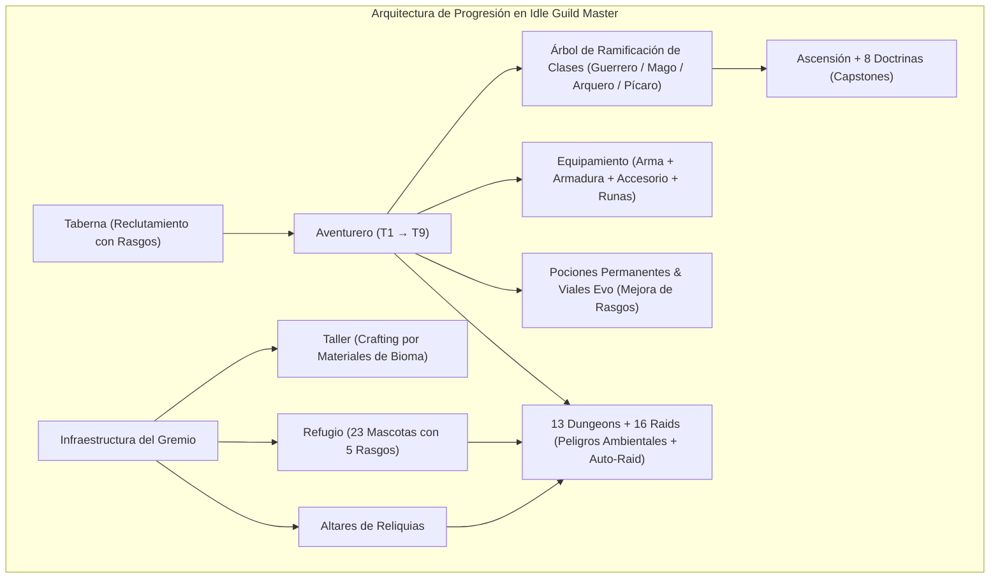

# Análisis Forense y de Diseño: *Idle Guild Master* (v2.148 / Mod v1.3.21.0)
## Oportunidades de Evolución para *Loot of the Dungeon (LoTD)*

> [!NOTE]
> Este informe extrae la arquitectura de dominio, fórmulas de combate, sistemas de progresión y mejoras de calidad de vida (*QoL*) presentes en el paquete `IdleGuildMaster_v2.148_mod_v1.3.21.0-release.apk` (`it.paranoidsquirrels.idleguildmaster`, **1,547 clases de dominio**) y los contrasta directamente con la arquitectura actual de [`LoTD-main`](file:///c:/Users/CBS-199/Downloads/LoTD-main/LoTD-main/App.tsx).

---

## 1. Radiografía Técnica del Archivo Analizado

- **Paquete base**: `it.paranoidsquirrels.idleguildmaster` (Kotlin/Java Android + JSON Snapshot Serializer).
- **Volumen de contenido**:
  - **169 clases de unidades aliadas / evoluciones** (`storage/data/entities/adventurers/units`), organizadas en árboles de promoción por *Tiers* (T1 a T9) y *Ascensión*.
  - **147 clases de enemigos y jefes** (`storage/data/entities/enemies/units`), divididos en **13 Calabozos (Dungeons)**, **16 Incursiones (Raids)** y **Bestiario con pestaña de Corrupción**.
  - **710 ítems** (`storage/data/items/instances`), abarcando armas con efectos al golpear, armaduras ligeras/medias/pesadas, accesorios, **Reliquias**, **Runas**, **Comida**, **Pociones permanentes de atributos** y **Viales de Evolución (Evo-20 a Evo-24)**.
  - **8 Doctrinas de Especialización** post-ascensión (`War`, `Fortitude`, `Ruin`, `Affliction`, `Control`, `Grace`, `Illusion`, `Knowledge`).
  - **23 Mascotas (Pets)** agrupadas en 8 familias taxonómicas (`Avian`, `Construct`, `Esoteric`, `Insect`, `Mythic`, `Reptile`, `Wild`, `Wooden`).
  - **10 Altares de Reliquias** (`AltarOfBlood`, `AltarOfDeath`, `AltarOfGreed`, `AltarOfImmortal`, etc.).

---

## 2. Los 7 Sistemas Estrella de *Idle Guild Master* (y Qué los Hace Adictivos)

### 2.1. Sistema Dual de Rasgos (*Common Traits* + *Rare Traits* + Evolución `PLUS`)
Cada héroe nace con un **Rasgo Común** (ej. `Feral`, `Bookworm`, `Brute`, `Athletic`, `Versatile`) y puede poseer un **Rasgo Raro** que define su arquetipo:
- **Ejemplos del Mod v1.3.21.0**:
  - `Troll Blood`: Regenera $0.5\%$ de HP máx. por Tier ($+4.5\%$ adicional si está Ascendido).
  - `Dragon Blood`: Reduce el daño recibido un $1\%$ por Tier ($+9\%$ si está Ascendido).
  - `Deadeye`: $+12\%$ Probabilidad de Crítico.
  - `Sundering`: Ignora el $20\%$ de la Defensa Física y Mágica del objetivo.
  - `Fortified`: Inicia cada batalla con un escudo igual al $20\%$ del HP máximo.
  - `Lone Wolf`: $+5\%$ de daño por cada espacio de aliado vacío o caído.
  - `Nocturnal`: Potencia estadísticas en función de la **Oscuridad** del calabozo.
- **Viales de Mutación (`Evo-20` a `Evo-24`)**: Ítems consumibles de endgame que permiten cambiar un rasgo o evolucionarlo permanentemente a su versión `PLUS` (`Feral+`, `Alert+`, `Ruthless+`).

### 2.2. Las 8 Doctrinas y sus *Capstones* (Diseño de Riesgo/Recompensa)
En lugar de pasivas planas, las **Doctrinas** ofrecen habilidades culminantes (*Capstones*) que cambian las reglas matemáticas del combate:
- **Doctrina de Aflicción (`Bloodletting`)**: Los ataques básicos consumen $5\% / 10\% / 15\%$ del HP máximo del héroe (no letal, hasta 1 HP) e infligen **Sangrado (Bleed)** equivalente al HP sacrificado.
- **Doctrina de Ruina (`Annihilation`)**: Los golpes críticos infligen $+30\% / +60\% / +90\%$ de daño adicional, pero el héroe sufre $5\%$ de su HP máximo como daño de retroceso (*recoil*) y **no puede robar vida (`0% Lifesteal`)**.
- **Doctrina de Guerra (`Titan's Might`)**: Convierte el $50\%$ de la Constitución (Vitalidad) en Daño Físico adicional.
- **Doctrina de Ilusión (`Evasive Riposte`)**: Esquivar un ataque contraataca inmediatamente por $50\% / 100\% / 150\%$ de daño físico.
- **Doctrina de Conocimiento (`Accelerated Mastery`)**: $10\% / 20\% / 30\%$ de probabilidad de reembolsar el $100\%$ del maná al lanzar una habilidad activa.
- **Doctrina de Gracia (`Sympathetic Ward`)**: Curar a un aliado también cura al lanzador un $10\% / 20\% / 30\%$ del monto curado.

### 2.3. Estados Alterados Avanzados y Reacciones Elementales
El motor de combate de *Idle Guild Master* (especialmente con los ajustes del Mod v1.3.21.0) destaca por interacciones profundas entre estados:
- **Bleed Shred (Desgarro de Armadura por Sangrado)**: Cada carga de Sangrado reduce la Defensa del enemigo en $0.1\%$ (hasta un máximo de $-15\%$ de armadura a las 150 cargas) **antes** de aplicar la fórmula de mitigación.
- **Bloodflame (Llama de Sangre)**: Quema por el $5\%$ del HP máximo como daño mágico al inicio del turno e **impide cualquier tipo de curación** (robo de vida, regeneración o curación directa).
- **Thermal Shock (Choque Térmico)**: Golpear a un objetivo **Congelado (`Frozen`)** rompe el hielo e inflige un estallido híbrido masivo ($+100\%$ a $+150\%$ de daño físico y mágico).
- **Brittle Toxin (Toxina Quebradiza)**: Atacar a un enemigo **Envenenado (`Poisoned`)** aplica *Brittle Toxin*, aumentando todo el daño que recibe en un $+20\%$ durante 2 turnos.

### 2.4. Peligros Ambientales por Bioma (*Environmental Hazards*)
Los calabozos no son simples fondos estéticos; cada zona impone una regla ambiental que obliga a adaptar el equipamiento:
- **Oscuridad (`Darkness`)**: Reduce la precisión y evasión del jugador salvo que lleve equipo luminoso (`Tidal Lantern`, pasivas `Night Vision` o bendición `Blessed`), mientras que ciertos monstruos abisales (`Gloom Angler Snapper`) escalan su velocidad y daño con la oscuridad de la sala.
- **Presión Abisal / Corrientes (`Sunken Citadel Currents`)**, **Ventiscas (`Blizzard`)**, **Trampas de Sala (`Golden City` / `Lost Expedition`)**.
- **Aparición de Jefes Ocultos por Ítem (`Apex Encounter Summoning`)**: Equipar un objeto específico como el *Tidal Lantern* otorga un $2.5\%$ de probabilidad por sala de invocar una criatura legendaria secreta (*Leviathan Hatchling*).

### 2.5. Economía de Materiales por Bioma y Taller (*Workshop Crafting*)
En vez de depender únicamente de botín aleatorio, cada monstruo suelta materiales temáticos de su anatomía (`WolfPelt`, `BoarTusk`, `BoneFragment`, `SpectralCloth`, `WurmScale`, `ObsidianChunk`) que se procesan en el **Taller** para fabricar equipamiento determinista de jefe (`WurmscalesJacket`, `UndeadCuirass`, `CursedBow`).

### 2.6. Sistema de Mascotas (*Shelter*) con Habilidades de Soporte
Las mascotas acompañan al héroe/grupo y aportan hasta 5 rasgos pasivos/activos en combate:
- `Decoy` (absorbe golpes), `Lifesteal`, `Heal`, `Opportunist`, `Experience`, `Drops`, o habilidades míticas como **Solar Rebirth** del Fénix *Kiara* (probabilidad por turno de revivir o impedir un golpe letal dejándolo a 1 HP).

### 2.7. Analítica Post-Exploración (*Adventure Recap* & *Bestiary*)
Cada zona registra métricas precisas en `adventureRecap`:
- Salas despejadas, conteo exacto de muertes por especie (`timesSlain`), XP ganada/perdida, tiempo transcurrido y un **Bestiario** interactivo donde el jugador consulta estadísticas, habilidades y botín de cada monstruo descubierto.

---

## 3. Comparativa Directa: *Idle Guild Master* vs. *Loot of the Dungeon (LoTD)*

| Dimensión | Estado Actual en `LoTD-main` | Enfoque en `Idle Guild Master (Mod v1.3.21)` | Oportunidad para `LoTD-main` |
| :--- | :--- | :--- | :--- |
| **Combate y Estados** | `poison`, `burn`, `bleed`, `stun`, `weak`, `vulnerable`, `shield`, `dodge_boost`. | **Reacciones encadenadas**: *Thermal Shock* (Congelado + Golpe), *Brittle Toxin*, *Bleed Armor Shred* y *Bloodflame* (anti-curación). | **Alta**: Añadir reacciones elementales/estados y *Bleed Armor Shred* en [`useCombatEngine.ts`](file:///c:/Users/CBS-199/Downloads/LoTD-main/LoTD-main/hooks/useCombatEngine.ts). |
| **Biomas / Mapas** | 5 terrenos (`PLAINS`, `FOREST`, `CRYPT`, `SWAMP`, `RUINS`, `VOID`) que afectan el pool visual de monstruos. | **Peligros Ambientales activos** por bioma (Oscuridad, Ventisca, Corrosión) e invocación de jefes secretos con reliquias. | **Alta**: Hacer que cada `TerrainType` en [`constants.ts`](file:///c:/Users/CBS-199/Downloads/LoTD-main/LoTD-main/constants.ts) tenga un modificador ambiental táctico (y que el ciclo Día/Noche interactúe con la Oscuridad). |
| **Progresión del Héroe** | Atributos base + Árbol de 57 pasivas + Sinergias de conjuntos. | **Rasgos de nacimiento** (Evolucionables a `PLUS`), **Pociones permanentes (Elixires)** y **Doctrinas con Capstones** de alto impacto. | **Media-Alta**: Incorporar *Elixires permanentes* como drops raros y *Capstones* tipo `Bloodletting` / `Titan's Might`. |
| **Economía e Ítems** | Generación procedural ARPG + Mercader + Contrabando (Gamble). | **Crafting por Materiales de Monstruo** + **Runas engarzables** + **Altares de Reliquias**. | **Media-Alta**: Añadir un sistema ligero de **Forja/Altar** o **Runas** para personalizar ítems Únicos. |
| **Compañeros / Mascotas** | Héroe solitario con skins animadas de entrenador. | **Refugio de Mascotas** e invocaciones (*Summons*) con habilidades propias en combate. | **Alta**: Dado que ya tenemos **skins de Entrenador** y **100 sprites animados**, ¡una **Mascota/Compañero activo** encaja al 100% con la identidad visual! |
| **Colección y Metas** | Nodos de mapa y dificultad de mundo (`worldDifficulty`). | **Bestiario con contador de bajas (`timesSlain`)**, desbloqueo de información de drops y **Misiones del Rey (`Quests`)**. | **Alta**: Crear un **Bestiario** que aproveche los 100 GIFs animados (normales y *Shiny*) y registre cuántos de cada especie hemos derrotado. |

---

## 4. Propuesta de Hoja de Ruta Inspirada en *Idle Guild Master* para *LoTD*

He estructurado las mejores ideas del APK en **4 Módulos Evolutivos** independientes para que podamos elegir cuáles implementar en *Loot of the Dungeon*:

### 🏆 Módulo A: Bestiario Interactivo y Caza de *Shinies* (`Bestiary & Monster Lore`)
- Aprovechar nuestro catálogo de **50 monstruos + 50 variantes *Shiny*** en [`spriteCatalog.ts`](file:///c:/Users/CBS-199/Downloads/LoTD-main/LoTD-main/services/spriteCatalog.ts).
- Registrar `timesSlain` y si la variante *Shiny* (Mythic) ha sido descubierta.
- Otorgar bonificaciones pasivas de maestría de caza al alcanzar hitos de bajas (ej. *10 bajas: +5% daño contra esa especie; 25 bajas: +10% Magic Find contra ella*).

### ⚡ Módulo B: Reacciones de Estado y Peligros Ambientales de Bioma (`Combat Depth 2.0`)
- **Bleed Shred**: Cada carga de sangrado reduce un porcentaje de la mitigación enemiga.
- **Bloodflame / Maldición Carmesí**: Estado que quema por % de vida máxima y corta la regeneración/robo de vida.
- **Reacciones de Estado**: Golpear a un enemigo *Aturdido/Congelado* o *Envenenado* detona daño adicional (*Thermal Shock / Brittle Toxin*).
- **Efectos de Bioma y Oscuridad**: Que la Cripta y el Vacío tengan **Oscuridad** (potenciada de Noche), el Pantano aplique corrosión leve, y las Ruinas aumenten la probabilidad de emboscadas o tesoros antiguos.

### 🐾 Módulo C: Sistema de Compañero / Mascota de Combate (`Battle Companion / Shelter`)
- Aprovechando que el héroe tiene estética de **Entrenador** y contamos con los sprites animados, permitir reclutar/equipar **1 Compañero/Mascota** activo en combate.
- El compañero actúa al final del turno (como las mascotas de *Idle Guild Master*: `Heal`, `Decoy Shield`, `Bleed Bite`, `Lifesteal Aura` o `Solar Rebirth`) y sube de nivel junto al héroe.

### ⚗️ Módulo D: Elixires Permanentes, Viales de Evolución y Encargos del Gremio (`Guild Quests & Elixirs`)
- **Elixires Permanentes**: Drops ultra-raros de Jefes (`Potion of Constitution`, `Potion of Viciousness`, etc.) que otorgan $+1$ o $+2$ permanente a una estadística (con límite máximo por personaje, igual que `potionsDrank` en IGM).
- **Tablón de Encargos (`King's Quests`)**: Micro-misiones dinámicas (ej. *"Derrota 5 monstruos en el Pantano"*, *"Asesta 10 golpes críticos"*, *"Limpia una zona en Postura Agresiva"*) que recompensan con Oro, Puntos de Talento o Elixires.
