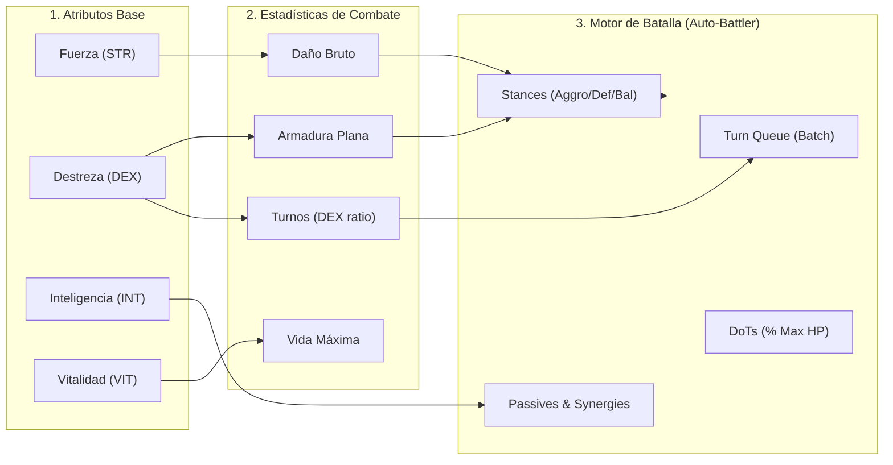
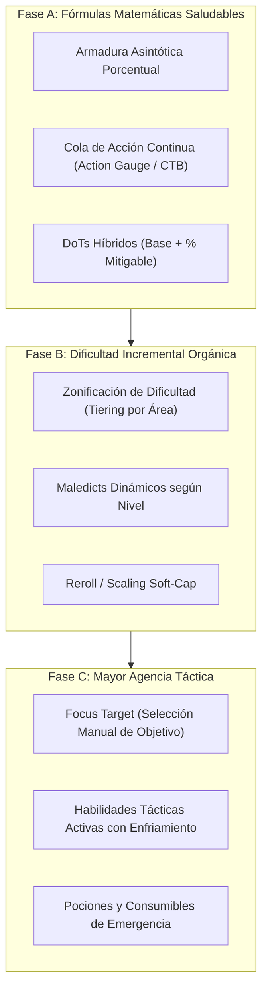

# Diagnóstico Exhaustivo: Mecánica de Batalla y Dificultad Incremental

Este documento presenta una auditoría técnica y matemática del motor de combate de **Loot of the Dungeon** (`useCombatEngine.ts`, `gameBalance.ts` y `gameLogic.ts`), analizando sus puntos de fricción, fallas en el escalado de dificultad y estrategias concretas de rediseño.

---

## 1. Radiografía del Sistema Actual



### Tabla de Fórmulas Actuales
| Componente | Fórmula Actual | Comportamiento / Vulnerabilidad |
| :--- | :--- | :--- |
| **Generación de Turnos** | $\text{Ratio} = \text{round}\left(\frac{\text{Agi}_A}{\text{Agi}_B}\right)$ | **Efecto Bola de Nieve**: Pequeñas ventajas en Destreza generan 2 o 3 turnos seguidos, bloqueando al rival. |
| **Mitigación de Armadura** | $\text{Daño} = \max(1, \text{RawDmg} - \text{Armor} \times 0.5)$ | **Resta Plana**: Si $\text{Armor} \times 0.5 \ge \text{Daño}$, el daño se vuelve 1 (inmunidad); si el daño supera la armadura, la defensa es inútil. |
| **Daño en el Tiempo (DoTs)** | $\text{Daño} = \text{MaxHP} \times \text{BaseVal} \times \text{Stacks}$ | **Porcentual No Mitigable**: Las quemaduras/venenos ignoran la armadura y vacían la vida en 3 turnos. |
| **Escalado de Dificultad** | $+0.02$ por enemigo / $+0.05$ por boss | **Espiral de Muerte**: Subir dificultad por cada victoria sin verificar el equipo del jugador conduce a muros infranqueables. |
| **Interacción del Jugador** | Postura + Huida (50% éxito) | **Baja Agencia**: El jugador no elige a qué monstruo atacar ni tiene habilidades activas manuales en turnos clave. |

---

## 2. Los 5 Problemas Críticos del Motor de Combate

### 1. Inestabilidad en la Cola de Turnos (*Agility Queue Exploitation*)
- **Mecánica actual**: El motor calcula cuántas veces ataca el jugador frente a la agilidad promedio del enemigo.
- **Falla**: Si el jugador lucha contra un grupo de 2 o 3 monstruos y la velocidad enemiga supera levemente a la del jugador, el turno enemigo activa el ataque de **todos los monstruos vivos en ráfaga**. Recibir 6 u 8 ataques consecutivos sin pausa produce muertes súbitas (*One-Shots*) imposibles de mitigar con reflejos o habilidad.

### 2. Reducción Plana de Daño (*Flat Damage Reduction*)
- **Mecánica actual**: `dmg = Math.max(1, Math.floor(rawDmg - (armor * 0.5)))`.
- **Falla**: Las fórmulas de sustracción directa son famosas en diseño de videojuegos por romper el balance:
  - En juego temprano: Si el jugador consigue un escudo con alta armadura, todos los enemigos le pegan 1 de daño (tedio, sin desafío).
  - En juego tardío: Cuando los monstruos escalan su daño con `worldDifficulty`, la armadura del héroe no alcanza a mitigar la ráfaga y el jugador es pulverizado en un turno.

### 3. Falta de Focalización de Objetivos (*Auto-Targeting*)
- **Mecánica actual**: El jugador siempre ataca a `activeMonsters.findIndex(m => m.currentHp > 0)`.
- **Falla**: Si en un combate grupal aparece un curandero o un enemigo con aura letal en la retaguardia (posición 2 o 3), el jugador está obligado a golpear al tanque frontal mientras recibe daño devastador de los flancos sin poder priorizar objetivos.

### 4. Castigo Punitivo al Caer (*Death Penalty*)
- Al perder una batalla, el código ejecuta:
  ```typescript
  setGold(p => Math.floor(p * 0.8)); // Pierde 20% oro
  setXp(p => Math.floor(p * 0.5));   // Pierde 50% de la XP acumulada
  ```
  Esto genera una trampa de progreso: el jugador muere porque su equipo es débil, pero pierde el oro necesario para comprar equipo en la tienda y la XP para subir de nivel y obtener puntos de atributo.

### 5. Los Efectos de Control Extremo (*Hard CC Stun-Lock*)
- El efecto `freeze` o `stun` salta el turno entero del jugador sin ofrecer resistencia progresiva (*diminishing returns*). Un monstruo con afijo de aturdimiento puede congelar al jugador repetidamente hasta derrotarlo sin que este pueda tomar una sola acción.

---

## 3. Plan Estratégico de Rediseño y Balance



---

## 4. Propuestas de Rediseño Específicas

### Estrategia 1: Mitigación de Daño Asintótica (Curva Diablo / PoE)
En lugar de restar directamente la armadura, convertirla en un porcentaje de reducción de daño dependiente del nivel:

$$\text{Mitigación \%} = \frac{\text{Armadura}}{\text{Armadura} + (50 \times \text{Nivel})}$$

$$\text{Daño Final} = \text{Daño Bruto} \times (1 - \text{Mitigación \%})$$

- **Beneficio**:
  - 100 de armadura a nivel 1 otorga ~66% de reducción (nunca 100%).
  - La armadura siempre aporta valor sin importar cuán alto sea el ataque del enemigo.
  - El daño recibido escala suavemente en lugar de saltar de 1 a 200 de golpe.

---

### Estrategia 2: Sistema de Turnos por Barra de Acción (ATB / CTB)
Sustituir el batch rígido `[player, player, player, enemy]` por un sistema de medidor de acción continuo:
- Cada combatiente tiene un indicador de tiempo de acción (Action Value) que se llena a una velocidad proporcional a su Destreza.
- Los monstruos individuales actúan en su propio turno, **no todos a la vez**.
- La ralentización (`chill`) reduce la velocidad a la que se llena la barra, retrasando el turno sin provocar aturdimiento total.

---

### Estrategia 3: Escalado de Dificultad por Nivel de Área (No Global Indiscriminado)
- **Problema actual**: Matar 10 enemigos en la primera zona eleva la dificultad mundial (`worldDifficulty`) a 1.25, haciendo que todas las zonas se vuelvan letales.
- **Solución propuesta**:
  - El multiplicador de dificultad debe depender del **progreso en la zona actual** (`areaProgress`), no de una variable global infinita.
  - Al completar un área (derrotar al Boss), se desbloquea el modo *Pesadilla* o *Tormento* para esa zona específica como elección voluntaria del jugador (con mayor Magic Find y más oro).
  - Si el jugador se siente atascado, puede regresar a una zona anterior para farmear sin penalización de dificultad acumulada.

---

### Estrategia 4: Incorporación de Acciones Tácticas del Jugador
Para convertir el combate en una experiencia más interactiva y estratégica:
1. **Targeting Táctico**: Hacer clic en cualquiera de los monstruos del grupo enemigo para marcarlo como objetivo prioritario.
2. **Acción de Emergencia: Poción de Vida**: Botón con 2-3 cargas por expedición para restaurar un 30% de HP cuando la batalla se complica.
3. **Resistencia a CC (*Tenacidad*)**: Cada vez que el héroe es aturdido o congelado, obtiene inmunidad a nuevos aturdimientos durante 2 turnos.

---

## 5. Comparativa: Antes vs. Después

| Aspecto | Implementación Actual | Con las Optimizaciones Propuestas |
| :--- | :--- | :--- |
| **Curva de Daño** | Escalonada y binaria (o 1 dmg o muerte) | Curva suave con reducción porcentual |
| **Ataques en Grupo** | Todos los monstruos atacan juntos en ráfaga | Monstruos intercalados según su velocidad individual |
| **Escalado de Zonas** | Dificultad global agresiva (+2% por combate) | Dificultad ligada al bioma con opción de reto voluntario |
| **Pérdida por Muerte** | 50% XP y 20% Oro (frustrante) | Pérdida leve de oro sin quitar niveles ni XP ya ganada |
| **Control del Jugador** | Solo postura (Aggressive/Defensive) | Postura + Selección de objetivo + Poción de emergencia |
