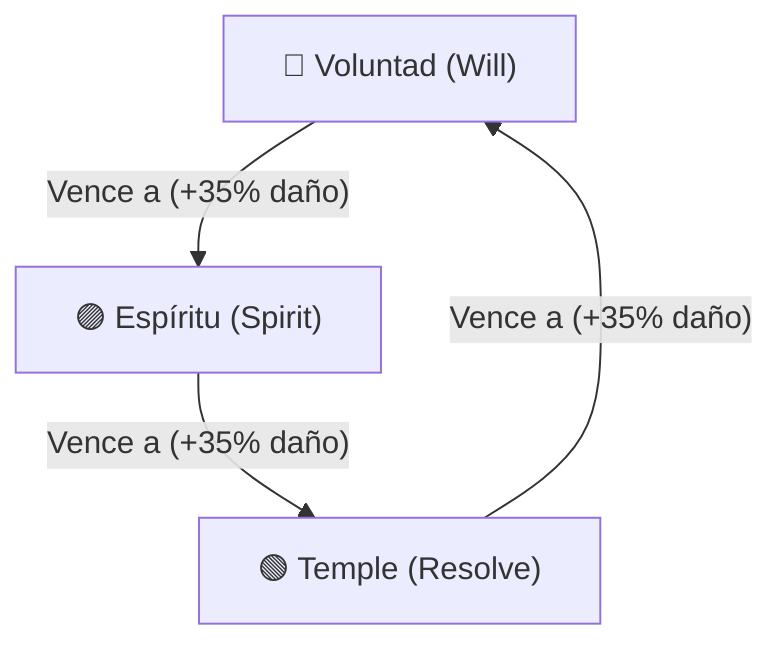

# Especificación Técnica y Arquitectura: Lord of the Dungeon (Versión 2)

Este documento detalla la especificación de diseño, balance y arquitectura técnica de la **Versión 2** de *Lord of the Dungeon*, incorporando las resoluciones integrales del protocolo de auditoría EGM. Abarca la renovación del sistema de combate hacia una dinámica activa tipo *Yan Ken Po* (Tríada de Posturas), temporizador de turnos reactivo, deducción de intenciones tácticas, reglas de combate multi-enemigo y la reestructuración matemática de estadísticas y botín.

---

## 1. Contexto, Objetivos y Alcance

### 1.1 Contexto y Limitaciones Previas
La Versión 1 del juego presentaba dos limitaciones estructurales críticas:
1. **Combate pasivo y determinista**: Las posturas de combate (antiguamente Agresiva, Defensiva, Equilibrada) actuaban como modificadores numéricos estáticos sobre ataque y defensa, sin toma de decisiones activa por parte del jugador durante el encuentro.
2. **Hiperinflación de estadísticas por objetos**: Los afijos de objetos de calidad superior otorgaban bonificaciones desproporcionadas respecto al escalado orgánico de nivel del héroe (35–70 en nivel 10), invalidando los atributos base y trivializando la progresión.

### 1.2 Objetivos Centrales (Goals)
- Transformar las posturas en una mecánica táctica en tiempo real basada en una tríada de dominancia cíclica (*Yan Ken Po*): **Voluntad**, **Espíritu** y **Temple**.
- Implementar un **temporizador de acción** de 2.5 segundos que sirva como ventana de decisión interactiva y límite de inactividad con ejecución automática.
- Añadir asimetría e incertidumbre táctica mediante la **ocultación de posturas** en enemigos de mayor jerarquía (Élites y Jefes), permitiendo contrajuego deductivo mediante arquetipos de estadísticas y la ventana de inspección (Codex).
- Establecer un presupuesto matemático equilibrado para afijos de objetos, curvas de probabilidad de caída con retornos decrecientes en `magicFind` y garantías en cofres de contrabando.

### 1.3 Objetivos Fuera de Alcance (Non-Goals)
- **No es un combate por turnos estático**: No se implementará un menú de pausa infinita para seleccionar habilidades; el flujo de batalla preserva el ritmo continuo del motor ATB.
- **No es un sistema elemental complejo**: No se agregarán afinidades elementales secundarias (Fuego, Hielo, Rayo) a la tríada en esta versión; la dinámica se restringe estrictamente a la tríada de tres posturas.
- **No se altera la persistencia externa**: La postura de combate es un estado reactivo de sesión dentro de `useCombatEngine`, no un dato guardado permanentemente en la base de datos del héroe entre partidas.

---

## 2. Dinámica de Combate: Tríada de Posturas (Yan Ken Po)

### 2.1 Definición y Simetría de la Tríada
Las tres posturas operan bajo un esquema cíclico de ventaja y desventaja rigurosamente simétrico:
- **Voluntad (Will - 🔴)**: Simboliza agresión directa, fuerza bruta e iniciativa mental. Vence a **Espíritu** y cede ante **Temple**.
- **Espíritu (Spirit - 🟣)**: Simboliza energía arcana, percepción y flujo místico. Vence a **Temple** y cede ante **Voluntad**.
- **Temple (Resolve - 🟢)**: Simboliza guardia férrea, disciplina física y tenacidad inquebrantable. Vence a **Voluntad** y cede ante **Espíritu**. Ninguna postura posee mitigación pasiva universal; la eficacia defensiva depende exclusivamente del choque relativo contra el atacante.



### 2.2 Modelo de Turnos y Evaluación de Choques (Clash Resolution)
A diferencia de un choque simultáneo bidireccional, el motor opera sobre una cola asincrónica secuencial por iniciativa (`turnQueue`: `'player'` | `'enemy'`). La ventaja de postura se evalúa por **evento de ataque** (`attackerStance` vs `defenderStance`):

1. **Turno del Jugador (`isPlayerTurn === true`)**:
   - El héroe ataca al enemigo seleccionado (`targetMonster` identificado por `selectedTargetId`).
   - Se invoca `resolveTriadClash(playerStance, enemyStance)` retornando `TriadClashResult`:
     - **`'WIN'` (Triunfo)**: Daño saliente del jugador multiplicado por **1.35x** (+35%). El banner muestra `⚔️ ¡TRIUNFO! +35% DMG`.
     - **`'LOSE'` (Desventaja)**: Daño saliente del jugador penalizado al **60%** (multiplicador 0.60x). El banner muestra `⚠️ DESVENTAJA (60% DMG)`.
     - **`'TIE'` (Empate)**: Daño neutro al **1.00x** (100%). El banner muestra `⚖️ CHOQUE PAREJO`.
2. **Turno del Enemigo (`isPlayerTurn === false`)**:
   - Cada enemigo vivo ataca individualmente al jugador.
   - Para cada atacante, se invoca `resolveTriadClash(monsterStance, playerStance)`:
     - **Si el enemigo gana (`'WIN'`)**: Penetra la guardia del jugador, reduciendo la mitigación de armadura base del héroe en `loseDefensePenaltyBonus = 0.15` (-15% mitigación).
     - **Si el enemigo pierde (`'LOSE'`)**: La postura del jugador contrarresta el golpe, incrementando la mitigación de armadura en `winDefenseMitigationBonus = 0.20` (+20% mitigación, hasta el tope del 85%).
     - **Si empatan (`'TIE'`)**: Se aplica la mitigación de armadura estándar calculada por la curva asintótica.

---

## 3. Ritmo de Combate, Temporizador y Comportamiento de IA

### 3.1 Intervalo de Acción y Compromiso Inmediato
- Al iniciar el turno del jugador, se inicializa el temporizador visual (`actionTimerProgress`) al **100%** con una ventana total `ACTION_TIME_MS = 2500` (2.5 segundos), decreciendo cada 50 ms hacia 0%.
- **Resolución Inmediata por Interacción**: Si el jugador presiona un botón de postura (`executeStanceAction`), la postura queda fijada, el intervalo se cancela de inmediato, la barra pasa a 0% y se ejecuta la acción en ese instante, garantizando fluidez total y eliminando tiempos muertos.
- **Autodisparo por Timeout**: Si el temporizador llega a 0% sin interacción manual, el motor ejecuta automáticamente el ataque utilizando la última postura seleccionada (`combatStanceRef.current`, por defecto `CombatStance.WILL`).

### 3.2 Comportamiento, Afinidad y Rotación de Monstruos
- **Afinidad Inicial**: Asignada proceduralmente en `services/gameLogic.ts` según el atributo predominante del monstruo:
  - `Strength >= Intelligence && Strength >= Dexterity` $\to$ **Voluntad (Will)**.
  - `Intelligence >= Strength && Intelligence >= Dexterity` $\to$ **Espíritu (Spirit)**.
  - En cualquier otro caso (defensivos o ágiles) $\to$ **Temple (Resolve)**.
- **Rotación Dinámica Post-Ataque**:
  - Al completar su ataque en `executeEnemyTurn`, el monstruo activo tiene un **45% de probabilidad** de rotar de postura.
  - Para evitar estrategias estacionarias y garantizar dinamismo real, la nueva postura se selecciona aleatoriamente entre las **dos posturas restantes** (`otherStances.filter(s => s !== currentStance)`), eliminando la posibilidad de re-seleccionar la misma postura en un roll exitoso.
- **Intención Oculta (`isStanceHidden`) y Deducción Táctica**:
  - Monstruos Comunes e Infrecuentes muestran siempre su postura de forma visible.
  - Enemigos Raros y Épicos tienen un **40%** de probabilidad de spawnear con postura oculta (`?`).
  - Monstruos Míticos y Jefes Únicos tienen un **60%** de probabilidad de spawnear con postura oculta (`?`).
  - **Neutralidad de Interfaz (Anti-Leak)**: La UI (`CombatModal`) no altera ni resalta los botones con ventaja o desventaja contextual frente a enemigos ocultos, preservando el desafío.
  - **Contrajuego por Deducción**: El jugador puede abrir el modal de inspección (`EnemyInspectModal`) para consultar el perfil de estadísticas del jefe (Fuerza = Voluntad, Inteligencia/Velocidad = Espíritu, Vitalidad/Armadura = Temple) y deducir la postura con alta probabilidad.

### 3.3 Reglas de Combate Multi-Enemigo (1 vs Varios)
- En encuentros con 2 o 3 monstruos (`activeMonsters: Monster[]`):
  1. El ataque del jugador impacta exclusivamente al objetivo seleccionado (`selectedTargetId`), evaluando el choque únicamente contra la postura de dicho objetivo.
  2. Si ocurre daño de hendidura (*Cleave/Splash* por remanente de daño), el daño transferido a objetivos secundarios se calcula de forma derivada sin re-evaluar la ventaja de postura.
  3. Durante la fase enemiga, cada monstruo ataca secuencialmente evaluando su propia postura contra la postura activa del héroe. La tirada de rotación del 45% se ejecuta de forma aislada por cada entidad que atacó.

---

## 4. Rebalance de Economía de Botín y Presupuesto de Afijos

### 4.1 Probabilidades de Calidad de Objetos (Drop Rates)
Las probabilidades base de caída y sus límites máximos escalados por dificultad se estructuran de la siguiente forma:

| Calidad | Probabilidad Base | Límite Máximo (Cap) | Afijos Totales | Multiplicador de Estadísticas |
| :--- | :---: | :---: | :---: | :---: |
| **Común (Common)** | ~75% - 78% | N/A | 1 afijo secundario | 1.00x |
| **Mágico (Magic)** | 18.0% | 35.0% | 2 afijos | 1.10x |
| **Raro (Rare)** | 3.5% | 8.5% | 3 afijos | 1.22x |
| **Único (Unique)** | 0.5% | 1.8% | 4 afijos + Efecto Especial | 1.35x |

### 4.2 Retornos Decrecientes en Hallazgo Mágico (Magic Find)
Para evitar que la acumulación de equipo con `magicFind` desestabilice la adquisición de objetos únicos, se aplica la curva hiperbólica asintótica:
$$\text{mfEffect} = 1 + \left(\frac{\text{safeMF}}{\text{safeMF} + 100}\right) \times 0.75$$
- Un valor de 100 de Magic Find otorga un incremento efectivo de calidad del +37.5% a +50%.
- El bono máximo teórico alcanzable está acotado asintóticamente al **+75%**, impidiendo la trivialización de botín de alta gama.

### 4.3 Presupuesto de Atributos por Afijo
El presupuesto de escalado por nivel para los atributos primarios (`STRENGTH`, `DEXTERITY`, `INTELLIGENCE`, `VITALITY`) se ajusta a:
$$\text{baseVal} = 1 + \lfloor \text{level} \times 0.75 \rfloor + \text{random}(0, 2)$$
- En nivel 10, un afijo primario genera entre **8 y 10** puntos base. Con el multiplicador de objeto Único (1.35x), el valor oscila entre **11 y 14**, alineado armónicamente con los 5 puntos por nivel del héroe.
- Atributos secundarios:
  - `DAMAGE`: $\max(2, \lfloor \text{level} \times 1.2 \rfloor) + \text{random}(1, 3)$
  - `ARMOR`: $\max(3, \lfloor \text{level} \times 2.0 \rfloor) + \text{random}(1, 4)$
  - `CRIT_CHANCE` / `DODGE_CHANCE`: 1% a 3% por afijo
  - `ATTACK_SPEED`: 2% a 5% por afijo
  - `MAGIC_FIND`: 2% a 6% por afijo

---

## 5. Evaluación de Alternativas Consideradas y Rechazadas

1. **Alternativa A: Menú Estático por Turnos sin Temporizador**:
   - *Descripción*: Pausar la batalla indefinidamente hasta que el jugador elija una postura o acción.
   - *Motivo de Rechazo*: Destruye la tensión dramática del combate en tiempo real y contradice la identidad visual ágil inspirada en RPGs tácticos continuos.
2. **Alternativa B: Sistema Elemental Pentagonal (5 Posturas/Elementos)**:
   - *Descripción*: Ampliar a Fuego, Agua, Tierra, Aire y Éter.
   - *Motivo de Rechazo*: Sobrecarga cognitiva excesiva para decisiones en ventanas de 2.5 segundos, redundancia de roles y complejidad innecesaria (violación de YAGNI).
3. **Alternativa C: Modificadores Numéricos Pasivos Estáticos (Versión 1)**:
   - *Descripción*: Mantener Agresiva (+15% ATK, -10% DEF) y Defensiva (-10% ATK, +20% DEF).
   - *Motivo de Rechazo*: Mecánica obsoleta que promovía una configuración óptima fija sin interactividad en el combate.
4. **Alternativa D: Bloqueo Obligatorio de Espera hasta el fin de los 2.5s**:
   - *Descripción*: Forzar al jugador a esperar a que la barra de progreso llegue al final tras hacer click.
   - *Motivo de Rechazo*: Identificada como antipatrón de latencia artificial durante la auditoría; generaba esperas de 5 a 7 segundos cuando el jugador encadenaba turnos consecutivos por agilidad.

---

## 6. Riesgos, Límites y Mitigaciones

| Riesgo / Límite Técnico | Impacto | Mitigación Implementada |
| :--- | :---: | :--- |
| **Desincronización de Temporizadores Reactivos** | Medio | Uso de referencias mutables (`actionIntervalRef`) con limpieza estricta en desmontaje y al confirmar acciones. |
| **Frustración por Azar en Jefes Ocultos (`isStanceHidden`)** | Alto | Inclusión de pistas deductivas por arquetipo en `EnemyInspectModal` y límite de probabilidad al 60% en jefes. |
| **Fuga de Información en UI de Posturas** | Medio | Los botones de la UI muestran la tríada de forma universal y estática sin destacar ventajas dinámicas sobre enemigos ocultos. |
| **Desbalance Económico por Acumulación de MF** | Alto | Aplicación de la fórmula de retornos decrecientes con techo asintótico estricto en `BALANCE.LOOT.caps`. |
| **Colapso de Combate Multi-Enemigo** | Medio | Focalización estricta de choques contra `selectedTargetId` y rotación de posturas acotada al atacante. |

---

## Detailed Implementation Plan

### 1. Modelo de Datos y Contratos de Tipos (`types.ts`)
- **Enumeración `CombatStance`**:
  ```typescript
  export enum CombatStance {
    WILL = 'Will',       // Voluntad (Vence a Espíritu)
    SPIRIT = 'Spirit',   // Espíritu (Vence a Temple)
    RESOLVE = 'Resolve'  // Temple (Vence a Voluntad)
  }
  ```
- **Extensión de la interfaz `Monster`**:
  - `currentStance?: CombatStance`: Postura activa en batalla.
  - `isStanceHidden?: boolean`: Oculta la insignia visual con un glifo `❓`.

### 2. Motor de Balance y Reglas Matemáticas (`services/gameBalance.ts`)
- **Configuración `BALANCE.COMBAT.triadConfig`**:
  - `advantages`: Mapeo directo de victorias cíclicas (`WILL -> SPIRIT`, `SPIRIT -> RESOLVE`, `RESOLVE -> WILL`).
  - `winDamageMult = 1.35`: Multiplicador de ataque victorioso.
  - `tieDamageMult = 1.00`: Daño neutro.
  - `loseDamageMult = 0.60`: Multiplicador de ataque en desventaja.
  - `winDefenseMitigationBonus = 0.20`: Bono de mitigación de armadura al defender.
  - `loseDefensePenaltyBonus = 0.15`: Penalización de mitigación al defender.
  - `actionTimerSeconds = 2.5`: Duración del ciclo de acción.
- **Función `resolveTriadClash(attackerStance: CombatStance, defenderStance: CombatStance): TriadClashResult`**:
  - Retorna `'WIN' | 'TIE' | 'LOSE'`.
- **Diccionario de Metadatos `STANCE_META`**:
  - Nombres, iconos, descripciones de ventaja/desventaja y clases cromáticas Tailwind (Rojo para Voluntad, Violeta para Espíritu, Esmeralda para Temple).

### 3. Generación y Lógica de Monstruos (`services/gameLogic.ts`)
- **Afinidad de Postura**:
  - Cálculo comparativo de `finalStr`, `finalInt` y `finalDex` en `generateMonster`.
- **Ocultamiento de Postura**:
  - Asignación de `isStanceHidden`: 40% en Rare/Epic, 60% en Mythic/Unique.

### 4. Hook del Motor de Combate (`hooks/useCombatEngine.ts`)
- **Estados Reactivos**:
  - `combatStance`: Postura actual del héroe (`CombatStance.WILL` por defecto).
  - `actionTimerProgress`: Valor de 100 a 0 que alimenta la barra visual.
  - `lastClashResult`: Objeto `{ playerStance, enemyStance, result, timestamp }`.
- **Mapeo de Acciones Inmediatas**:
  - `executeStanceAction`: Cancela el temporizador y ejecuta `resolveCombatTurn` al instante.
- **Rotación de Postura del Enemigo**:
  - Al completar `executeEnemyTurn`, si el roll del 45% se cumple, se elige una postura entre `otherStances.filter(s => s !== enemyStance)`.

### 5. Interfaz de Usuario e Integración Visual
- **`components/CombatModal.tsx`**:
  - Barra de progreso horizontal reactiva con gradiente ámbar.
  - Tres botones de postura en la barra táctica con atajos táctiles.
  - Banner dinámico con leyendas literales: `'⚔️ ¡TRIUNFO! +35% DMG'`, `'⚠️ DESVENTAJA (60% DMG)'`, `'⚖️ CHOQUE PAREJO'`.
  - Medallas de postura visibles o indicador `❓` si `isStanceHidden` es verdadero.
- **`components/EnemyInspectModal.tsx`**:
  - Panel informativo con consejos tácticos contra la postura del enemigo, o sugerencia deductiva de atributos si la postura es oculta.

### 6. Arquitectura de Generación de Botín y Economía (`services/gameLogic.ts` & `constants.ts`)
- **`generateLoot(level, difficulty, magicFind, forcedRarity)`**:
  - Cálculo de `currentDropChance` con escalado por dificultad.
  - Aplicación de `mfEffect = 1 + (safeMf / (safeMf + 100)) * 0.75`.
  - Selección de afijos respetando el catálogo arquetípico de *Idle Guild Master*.
- **`components/SmugglingModal.tsx`**:
  - Paquetes de contrabando con rarezas mínimas garantizadas para evitar estafas al jugador:
    - *Common Chest* (100g): Mínimo Mágico garantizado.
    - *Smuggler's Crate* (350g): Mínimo Raro garantizado.
    - *Black Market Vault* (1,200g): Mínimo Raro con 25% de probabilidad de Único.

### 7. Verificación de Integración y Despliegue
- Verificación estricta de tipos con `npx tsc --noEmit`.
- Compilación de producción con `npm run build`.
- Despliegue sincronizado a la rama `gh-pages` de GitHub.
