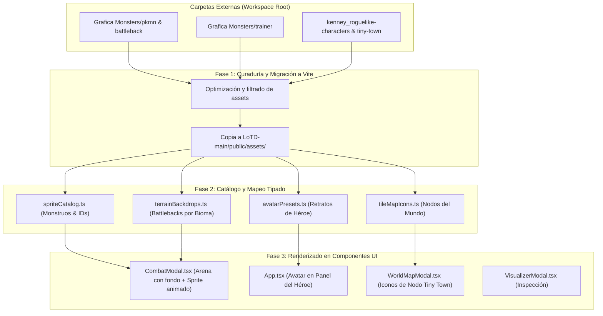
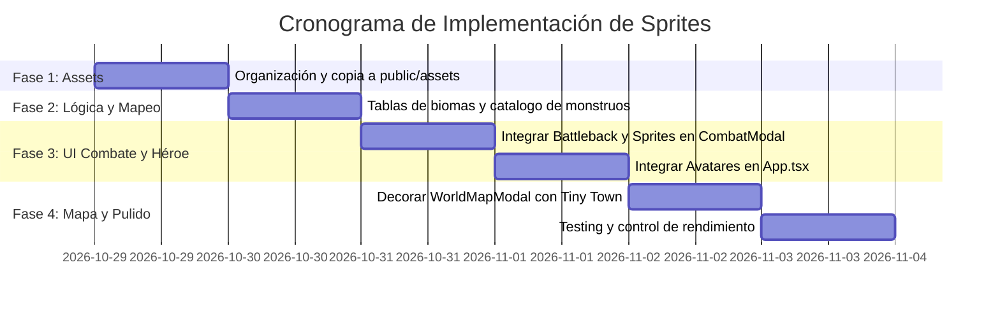

# Plan de Trabajo: Integración de Recursos Gráficos y Sprites en Loot of the Dungeon

Este documento establece la estrategia técnica, arquitectónica y de diseño para transformar la línea gráfica de **Loot of the Dungeon (LoTD)**, migrando de iconos sintéticos vectoriales y texturas genéricas a un sistema visual enriquecido con los assets disponibles en el entorno local.

---

## 1. Inventario y Clasificación de Recursos Disponibles

Tras la inspección forense del workspace, se identificaron tres fuentes de recursos independientes:

| Carpeta de Origen | Formatos | Cantidad | Destino en LoTD | Rol Visual |
| :--- | :--- | :--- | :--- | :--- |
| **`Grafica Monsters/pkmn` y `pkmn_shiny`** | GIF animados (transparentes) | +3,100 archivos | `CombatModal`, `VisualizerModal`, Miniaturas de combate | Representación animada de monstruos, élites y jefes de área. |
| **`Grafica Monsters/battleback`** (`realistic` / `traditional`) | GIF / PNG | Cientos de fondos | `CombatModal` (Fondo de arena de batalla) | Ambientación según el bioma (`TerrainType`: bosque, cripta, pantano, ruinas). |
| **`Grafica Monsters/trainer`** | PNG / GIF | 666 archivos | `App.tsx` (Panel izquierdo), Selector de personaje | Retratos y avatares del héroe. |
| **`kenney_roguelike-characters`** | PNG (Spritesheet 16x16) | 1 hoja packed (54+ personajes) | Iconos de clase, avatares pixel art, NPCs comerciantes | Visualización del héroe en estilo Roguelike clásico. |
| **`kenney_tiny-town`** | PNG (132 tiles individuales 16x16) | 132 tiles + tilemap | `WorldMapModal.tsx`, cabeceras de área | Gráficos para nodos del mapa mundial, caminos, edificios y biomas. |

---

## 2. Arquitectura de Integración en Vite / React

---

## 3. Fases de Implementación

### Fase 1: Estructuración y Gestión de Assets en Vite
> [!IMPORTANT]
> Vite sólo sirve estáticamente de manera directa los archivos ubicados dentro de la carpeta `public/` del proyecto (`LoTD-main/LoTD-main/public/`). No se deben vincular rutas relativas que salgan fuera de la raíz de Vite hacia carpetas hermanas en tiempo de ejecución.

1. **Creación del directorio público de assets**:
   - Crear la ruta `LoTD-main/LoTD-main/public/assets/`.
   - Subcarpetas:
     - `public/assets/monsters/` (Selección curada o catálogo de monstruos).
     - `public/assets/battlebacks/` (Arenas de combate por bioma).
     - `public/assets/heroes/` (Retratos de héroes/entrenadores).
     - `public/assets/tiles/` (Tiles de Tiny Town para el mapa).
2. **Estrategia de carga de GIFs masivos**:
   - Dado que `Grafica Monsters/pkmn` contiene 1,563 archivos, no es recomendable cargarlos todos en memoria a la vez. Se utilizará carga bajo demanda (*lazy loading*) mediante URLs absolutas del servidor (`/assets/monsters/${monsterSpriteId}.gif`).

---

### Fase 2: Mapeo de Datos y Definiciones Tipadas

1. **Mapeo de Biomas a Fondos de Batalla (`terrainBackdrops.ts`)**:
   Vincular el enum existente `TerrainType` con los fondos GIF de `battleback`:

   | `TerrainType` | Nombre del Bioma | Fondo Sugerido (`battleback/realistic/`) |
   | :--- | :--- | :--- |
   | `TerrainType.RUINS` | Ruinas Antiguas | Fondos de templos derruidos, columnas de piedra |
   | `TerrainType.FOREST` | Bosque Prohibido | Fondos boscosos, arboledas umbrías |
   | `TerrainType.CRYPT` | Criptas de la Oscuridad | Fondos de catacumbas, mazmorras de piedra |
   | `TerrainType.SWAMP` | Pantano de Sangre | Fondos pantanosos, niebla y aguas estancadas |
   | `TerrainType.PLAINS` | Planicies del Vértice | Fondos campestres abiertos o senderos |
   | `TerrainType.VOID` | El Vacío | Fondos cósmicos / abstractos de la carpeta |

2. **Mapeo de Monstruos (`services/monsterCatalog.ts`)**:
   - Actualmente `gameLogic.ts` genera nombres genéricos (`Skeleton`, `Demon`, `Spider`, `Zombie`).
   - Se creará una tabla relacional que asigne a cada arquetipo un sprite ID coherente (ejemplo: arquetipos no-muertos, espectrales, demoníacos, bestias) y use variantes Shiny para monstruos de rareza `Unique` o `Mythic`.

---

### Fase 3: Integración en Componentes React

1. **Escenario de Combate (`CombatModal.tsx`)**:
   - **Capa 0 (Fondo)**: Reemplazar el fondo gris oscuro plano por el GIF de `battleback` correspondiente al terreno de la zona actual.
   - **Capa 1 (Monstruo)**: Mostrar el sprite GIF animado centrado en la mitad superior de la arena con sombra proyectada en el suelo (`drop-shadow`).
   - **Feedback de impacto**: Añadir animaciones CSS (sacudida/parpadeo en rojo cuando el monstruo recibe daño, o flash dorado en golpes críticos).

2. **Panel de Héroe (`App.tsx`)**:
   - Sustituir el marco vacío (`bg-[#080808]`) por un selector de avatar que permita al jugador elegir un retrato inicial de `trainer` o un personaje de `kenney_roguelike-characters`.
   - Si no se genera una imagen con IA, se mostrará el avatar del sprite seleccionado como predeterminado.

3. **Mapa del Mundo (`WorldMapModal.tsx`)**:
   - Integrar los tiles de `kenney_tiny-town` como iconos visuales para cada nodo (`town`, `crypt`, `swamp`, `forest_edge`, etc.).
   - Utilizar tiles de caminos y árboles para conectar visualmente los nodos desbloqueados.

---

### Fase 4: Pruebas, Rendimiento y Retrocompatibilidad

1. **Rendimiento de GIFs**:
   - Evaluar el consumo de memoria en navegadores durante batallas prolongadas. Los navegadores pausan GIFs que no están montados en el DOM; desmontar el modal al finalizar el combate liberará la memoria de animación.
2. **Retrocompatibilidad con IA**:
   - Si el usuario configura su `GEMINI_API_KEY` y solicita generar un monstruo con IA, la imagen generada por IA tomará precedencia sobre el sprite base, manteniendo intacta la funcionalidad original.

---

## 4. Cronograma de Tareas (Roadmap)

---

## 5. Decisiones de Diseño Abiertas

Antes de proceder con la ejecución del código, se requiere definir:
1. **Estilo del Héroe**: ¿Deseas que los avatares seleccionables del héroe sean los retratos de entrenadores (`Grafica Monsters/trainer`) o prefieres el estilo pixel-art de Kenney (`kenney_roguelike-characters`)?
2. **Volumen de Monstruos**: ¿Deseas vincular un conjunto selecto de ~30 a 50 monstruos icónicos bien categorizados por bioma, o prefieres una asignación amplia sobre todo el banco de sprites?
