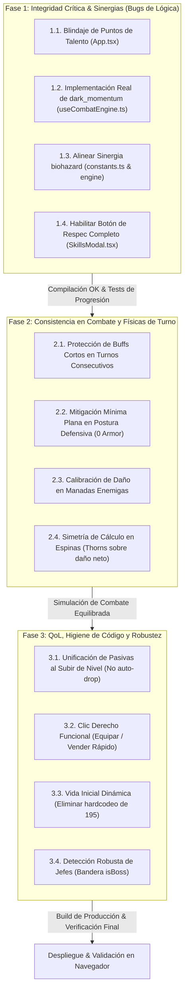

# Plan de Trabajo para la Resolución de Incompatibilidades y Optimización del Motor de Juego
**Proyecto:** *Loot of the Dungeon (LoTD)*  
**Fecha de Planificación:** Noviembre 2026  
**Objetivo:** Resolver las 12 incompatibilidades y anomalías detectadas en la auditoría forense, asegurando integridad en la progresión, consistencia en el combate táctico y una experiencia de usuario fluida y reactiva.

---

## 1. Arquitectura del Plan de Trabajo

El plan se estructura en **3 Fases Secuenciales**, agrupadas por cercanía de código y dependencias de estado para evitar retrabajos, regresiones o inconsistencias de compilación.

---

## 2. Detalle de Ejecución por Fases (✅ 100% COMPLETADO)

---

### 🛡️ Fase 1: Integridad Crítica & Sinergias (Bugs de Lógica y Datos) — ✅ COMPLETADA
*Foco: Eliminar bugs que destruyen recursos del jugador y dar efecto real al código inoperante.*

| Tarea | Archivos Afectados | Descripción Técnica | Estado |
| :--- | :--- | :--- | :--- |
| **1.1. Blindaje de Puntos de Talento** | [`App.tsx`](file:///c:/Users/CBS-199/Downloads/LoTD-main/LoTD-main/App.tsx) | Comprobación `existingSkill.level >= maxRank` al inicio de `handleUnlockTreeSkill`. Si está maximizado, emite advertencia y sale sin decrementar `skillPoints`. | ✅ Verificado |
| **1.2. Activación de `dark_momentum`** | [`useCombatEngine.ts`](file:///c:/Users/CBS-199/Downloads/LoTD-main/LoTD-main/hooks/useCombatEngine.ts), [`constants.ts`](file:///c:/Users/CBS-199/Downloads/LoTD-main/LoTD-main/constants.ts) | Al esquivar un golpe con `dark_momentum`, otorga buff `dodge_boost` (+35% evasión por 2 turnos) e inyecta turno extra inmediato en `turnQueue`. | ✅ Verificado |
| **1.3. Alinear Sinergia `biohazard`** | [`constants.ts`](file:///c:/Users/CBS-199/Downloads/LoTD-main/LoTD-main/constants.ts), [`useCombatEngine.ts`](file:///c:/Users/CBS-199/Downloads/LoTD-main/LoTD-main/hooks/useCombatEngine.ts) | En `onTakeDamage`, aplica veneno reactivo al atacante durante 3 turnos, manteniendo el bono de daño ofensivo del 20% contra objetivos envenenados. | ✅ Verificado |
| **1.4. Botón y Flujo de *Respec*** | [`SkillsModal.tsx`](file:///c:/Users/CBS-199/Downloads/LoTD-main/LoTD-main/components/SkillsModal.tsx), [`App.tsx`](file:///c:/Users/CBS-199/Downloads/LoTD-main/LoTD-main/App.tsx) | Botón `Reset Build ({cost}g)` en `SkillsModal`. Reembolsa atributos (`(level - 1) * 3`) y puntos de talento (`(level - 1) * 1`), limpiando habilidades y descontando oro. | ✅ Verificado |

---

### ⚔️ Fase 2: Consistencia en el Motor de Combate y Físicas de Turno — ✅ COMPLETADA
*Foco: Eliminar trampas matemáticas y garantizar que la cola de turnos y las posturas respondan con total equidad.*

| Tarea | Archivos Afectados | Descripción Técnica | Estado |
| :--- | :--- | :--- | :--- |
| **2.1. Protección de Buffs en Turnos Consecutivos** | [`useCombatEngine.ts`](file:///c:/Users/CBS-199/Downloads/LoTD-main/LoTD-main/hooks/useCombatEngine.ts) | Buffs defensivos (`shield`, `dodge_boost`) no se consumen durante turnos consecutivos del héroe; su decremento ocurre al final de los turnos de ataque del enemigo. | ✅ Verificado |
| **2.2. Mitigación Mínima en Postura Defensiva** | [`useCombatEngine.ts`](file:///c:/Users/CBS-199/Downloads/LoTD-main/LoTD-main/hooks/useCombatEngine.ts) | Piso de mitigación garantizado del 15% (`minFloor = 0.15`) en postura defensiva aunque el héroe tenga 0 de armadura. | ✅ Verificado |
| **2.3. Calibración de Manadas Enemigas** | [`gameLogic.ts`](file:///c:/Users/CBS-199/Downloads/LoTD-main/LoTD-main/services/gameLogic.ts) | Escalado balanceado en `generateEncounter`: 2 enemigos infligen 50% de daño c/u (100% total); 3 enemigos infligen 35% c/u (105% total), eliminando picos de burst insalvables. | ✅ Verificado |
| **2.4. Simetría de Cálculo en Espinas** | [`useCombatEngine.ts`](file:///c:/Users/CBS-199/Downloads/LoTD-main/LoTD-main/hooks/useCombatEngine.ts) | Reflejo simétrico de espinas calculado sobre daño neto `dmg` posterior a armadura, escudos y críticos. | ✅ Verificado |

---

### 🎮 Fase 3: Calidad de Vida (QoL), Higiene y Robustez — ✅ COMPLETADA
*Foco: Elevar la ergonomía del inventario y eliminar fragilidades técnicas.*

| Tarea | Archivos Afectados | Descripción Técnica | Estado |
| :--- | :--- | :--- | :--- |
| **3.1. Unificación de Pasivas en Subida de Nivel** | [`App.tsx`](file:///c:/Users/CBS-199/Downloads/LoTD-main/LoTD-main/App.tsx), [`LevelUpModal.tsx`](file:///c:/Users/CBS-199/Downloads/LoTD-main/LoTD-main/components/LevelUpModal.tsx) | Desvinculada la asignación aleatoria automática al subir de nivel: el jugador recibe sus +3 puntos de atributo y +1 punto de talento para invertir con total agencia en el árbol. | ✅ Verificado |
| **3.2. Clic Derecho Funcional (Equipar / Vender)** | [`App.tsx`](file:///c:/Users/CBS-199/Downloads/LoTD-main/LoTD-main/App.tsx), [`InventorySlot.tsx`](file:///c:/Users/CBS-199/Downloads/LoTD-main/LoTD-main/components/InventorySlot.tsx) | Implementado `handleItemRightClick` para equipar/desequipar con clic derecho, trasladar a venta al interactuar con el mercader, y botón masivo `Sell Commons`. | ✅ Verificado |
| **3.3. Vida Inicial Dinámica** | [`App.tsx`](file:///c:/Users/CBS-199/Downloads/LoTD-main/LoTD-main/App.tsx) | Reemplazado hardcodeo `195` por fórmula dinámica ligada a `BALANCE.STATS`: `100 + (vitality * 8) + (level * 15)`. | ✅ Verificado |
| **3.4. Detección Robusta de Jefes** | [`types.ts`](file:///c:/Users/CBS-199/Downloads/LoTD-main/LoTD-main/types.ts), [`App.tsx`](file:///c:/Users/CBS-199/Downloads/LoTD-main/LoTD-main/App.tsx) | Bandera formal `isBoss?: boolean` en `Monster`. Integrada en generación y victoria de combate para avance infalible de áreas en el mapa. | ✅ Verificado |
| **3.2. Clic Derecho Funcional (Equipar / Vender)** | [`App.tsx`](file:///c:/Users/CBS-199/Downloads/LoTD-main/LoTD-main/App.tsx#L1084), [`InventorySlot.tsx`](file:///c:/Users/CBS-199/Downloads/LoTD-main/LoTD-main/components/InventorySlot.tsx) | En `App.tsx`, implementar `onRightClick`:  - Con mercader abierto: enviar a la cesta de venta. - Fuera de la tienda: equipar/desequipar automáticamente al slot correspondiente. | Clic derecho traslada/equipa ítems de inmediato sin necesidad de arrastrar. |
| **3.3. Vida Inicial Dinámica** | [`App.tsx`](file:///c:/Users/CBS-199/Downloads/LoTD-main/LoTD-main/App.tsx#L158) | Reemplazar `setPlayerCurrentHp(195)` por `calculatePlayerStats` para asegurar que `playerCurrentHp` nazca de la fórmula centralizada de balance. | Inicio de partida completamente alineado con las fórmulas del sistema. |
| **3.4. Detección Robusta de Jefes** | [`types.ts`](file:///c:/Users/CBS-199/Downloads/LoTD-main/LoTD-main/types.ts), [`App.tsx`](file:///c:/Users/CBS-199/Downloads/LoTD-main/LoTD-main/App.tsx#L407, L704) | Agregar la bandera `isBoss?: boolean` en la interfaz `Monster`. Al derrotar un enemigo, validar `m.isBoss === true` en lugar de la búsqueda textual `m.name.includes('Overlord')`. | El mapa avanza y desbloquea áreas independientemente del nombre o traducción del jefe. |

---

## 3. Matriz de Dependencias y Validación Técnica

```mermaid
gantt
    title Cronograma de Implementación y Pruebas
    dateFormat  X
    axisFormat %s
    section Fase 1
    Blindaje de Skill Points & Respec UI     :active, 0, 1
    Sinergias dark_momentum & biohazard      :active, 1, 2
    section Fase 2
    Protección de Buffs & Armadura 0         :2, 3
    Manadas de Monstruos & Espinas           :3, 4
    section Fase 3
    Unificación de Pasivas & Clic Derecho    :4, 5
    Limpieza de Hardcodeo & Bandera isBoss   :5, 6
    section Verificación
    Tests Automatizados Monte Carlo & Build  :6, 7
```

### Protocolo de Verificación Automatizada:
1. **Compilación Estricta**: `npx tsc --noEmit` debe dar **0 errores**.
2. **Build de Producción**: `npm run build` debe empaquetar limpiamente en Vite.
3. **Simulación Headless de Combate**: Ejecutar simulación de 100 combates en todas las posturas para validar que:
   - En postura defensiva con 0 armadura se mitiga daño ($>0\%$).
   - Las manadas de 3 monstruos no superan el 105% de daño combinado.
   - Las espinas no devuelven daño contra escudos arcanos.
   - El reseteo de pasivas devuelve el 100% de los puntos gastados.
