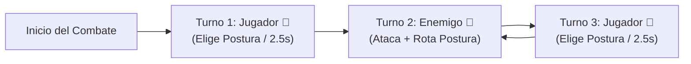

# 📋 Plan de Acción Actualizado: Turnos Alternos 1:1 y Sistema de "Reacción Rápida" (Parry / Finta)

**Autor:** Antigravity  
**Proyecto:** Lord of the Dungeon (V2 - Dinámica Tríada Yan Ken Po)  
**Fecha:** 9 de Noviembre de 2026  
**Estado:** Alineado con las Decisiones del Usuario — Listo para Ejecución  

---

## 1. Diagnóstico de la Problemática de Turnos

1. **Causa Raíz del Bug ("Turnos Infinitos"):**  
   El motor en [`hooks/useCombatEngine.ts`](file:///home/antigravity/LoTD-main/hooks/useCombatEngine.ts#L20-L51) mantenía `generateTurnBatch`, un medidor acumulativo heredado de la V1 donde si el enemigo superaba en Destreza al jugador (`eAgi > pAgi`), acumulaba turnos seguidos en la cola (`['enemy', 'enemy', 'enemy', 'enemy']`). Además, el `useEffect` de las líneas 234-251 re-encolaba lotes adicionales antes de vaciar la cola, encadenando ataques enemigos sin dar opción al jugador.
2. **Incompatibilidad con la V2:**  
   En la dinámica Yan Ken Po (Voluntad, Espíritu, Temple), cada turno gira en torno a la elección de postura. No deben existir turnos dobles ni aceleración de turnos.

---

## 2. Definición de la Nueva Mecánica Acordada

### 2.1. Regla de Turnos: Iniciativa Fija del Jugador + Alternancia Estricta 1:1
- **Apertura de Combate:** El **Jugador siempre abre el primer turno** en el 100% de los combates.
- **Secuencia Invariante:** La cola de turnos es estrictamente alterna `1:1`:
  `['player', 'enemy', 'player', 'enemy', 'player', 'enemy', ...]`
- **Fin de los Turnos Dobles:** Ningún atributo, habilidad ni penalización (como *Chill*) puede otorgar turnos múltiples ni alterar el orden 1:1.



---

### 2.2. Transformación de "Attack Speed" en **"Reacción Rápida"** (Quick Reaction)

El atributo `StatType.ATTACK_SPEED` pasa a denominarse y funcionar como **Reacción Rápida** (*Quick Reaction*), actuando como una red de seguridad táctica tanto en ataque (**Finta**) como en defensa (**Parry**):

| Mecánica | Fase en que Actúa | Condición de Activación | Probabilidad (Escala con Reacción Rápida) | Efecto en Combate |
| :--- | :--- | :--- | :--- | :--- |
| **🤺 Finta (Feint)** | **Ataque del Jugador** | El jugador **falla** en la elección de postura (`clash === 'LOSE'`, donde normalmente haría solo 60% de daño). | $\text{Probabilidad Finta} = \min(35\%, \text{Reacción Rápida} \times 0.6\%)$ | **Recupera el golpe:** Anula la penalización de postura fallida y conecta el golpe con **100% del daño normal** (`1.0x` en lugar de `0.60x`). |
| **🗡️ Parry (Parada)** | **Defensa del Jugador** | El jugador **recibe un ataque** enemigo (especialmente útil si falló la postura defensiva). | $\text{Probabilidad Parry} = \min(50\%, \text{Reacción Rápida} \times 1.0\%)$ | **Mitigación de reflejos:** Desvía parcialmente el impacto, reduciendo el daño final recibido en un **35% adicional**. |

> [!TIP]
> **Sinergia con Destreza e Ítems:**
> - Cada punto de **Destreza** otorga $+0.2\%$ de Reacción Rápida base, además de los bonos directos de equipamiento (dagas, botas, guantes, anillos) que tengan el stat de Reacción Rápida.
> - El efecto *Chill* (Escarcha), que antes reducía turnos, ahora reduce temporalmente la probabilidad de **Reacción Rápida y Esquiva**, manteniendo su relevancia táctica sin romper la cola 1:1.

---

## 3. Plan de Implementación Técnica (Paso a Paso)

### Paso 1: Cola de Turnos 1:1 en [`hooks/useCombatEngine.ts`](file:///home/antigravity/LoTD-main/hooks/useCombatEngine.ts)
1. Reemplazar `generateTurnBatch` por un generador determinista 1:1 que siempre inicia con `'player'`:
   ```ts
   export const generateTurnBatch = (_playerAgi?: number, _enemyAgi?: number): ('player' | 'enemy')[] => {
       return ['player', 'enemy', 'player', 'enemy', 'player', 'enemy'];
   };
   ```
2. En el `useEffect` de mantenimiento de cola (líneas 234-251), asegurar que al recargar cuando `turnQueue.length < 2`, continúe la alternancia exacta mirando el último elemento de la cola:
   ```ts
   if (turnQueue.length < 2) {
       const lastActor = turnQueue[turnQueue.length - 1] || 'enemy';
       const nextBatch: ('player' | 'enemy')[] = lastActor === 'player'
           ? ['enemy', 'player', 'enemy', 'player', 'enemy', 'player']
           : ['player', 'enemy', 'player', 'enemy', 'player', 'enemy'];
       setTurnQueue(prev => [...prev, ...nextBatch]);
   }
   ```

### Paso 2: Implementación de Finta y Parry en [`hooks/useCombatEngine.ts`](file:///home/antigravity/LoTD-main/hooks/useCombatEngine.ts)
1. **En `resolveCombatTurn` (Turno del Jugador - Finta):**
   - Cuando `clash === 'LOSE'`:
     - Calcular `feintChance = Math.min(35, (playerStats.attackSpeed || 0) * 0.6)`.
     - Si `Math.random() * 100 < feintChance`:
       - El multiplicador de postura pasa de `0.60` a `1.00` (golpe limpio).
       - Registrar en el log de combate: `🤺 ¡FINTA RÁPIDA! Pese a fallar la postura, corriges tu trayectoria y conectas un golpe limpio (100% daño)!`
2. **En `executeEnemyTurn` (Turno del Enemigo - Parry):**
   - Al recibir un impacto no esquivado:
     - Calcular `parryChance = Math.min(50, (playerStats.attackSpeed || 0) * 1.0)`.
     - Si `Math.random() * 100 < parryChance`:
       - Reducir el daño recibido en un **35%** (`final = Math.max(1, Math.floor(final * 0.65))`).
       - Registrar en el log de combate: `🗡️ ¡PARRY! Tu Reacción Rápida desvía el filo de ${monster.name} (-35% daño)!`

### Paso 3: Actualización de Atributos y UI
1. **[`services/gameLogic.ts`](file:///home/antigravity/LoTD-main/services/gameLogic.ts):**
   - Añadir escalado ligero de Destreza hacia Reacción Rápida (`currentStats.attackSpeed += Math.floor(currentStats.dexterity * 0.2)`).
2. **[`components/HeroCombatStatsModal.tsx`](file:///home/antigravity/LoTD-main/components/HeroCombatStatsModal.tsx), [`components/StatsModal.tsx`](file:///home/antigravity/LoTD-main/components/StatsModal.tsx) y [`components/Tooltip.tsx`](file:///home/antigravity/LoTD-main/components/Tooltip.tsx):**
   - Actualizar las etiquetas y descripciones de `Attack Speed` para mostrar **Reacción Rápida (Parry / Finta)** junto con los porcentajes desglosados de probabilidad de Parry y Finta.

### Paso 4: Verificación y Despliegue
1. Crear y correr script de validación [`scripts/playtest_turns_and_reaction_v2.ts`](file:///home/antigravity/LoTD-main/scripts/playtest_turns_and_reaction_v2.ts) para verificar:
   - Cero ocurrencias de turnos dobles en 10,000 turnos simulados.
   - Jugador siempre abre el turno 1.
   - Activación estadística exacta de **Parry** y **Finta**.
2. Compilar (`npx tsc --noEmit` y `npm run build`), actualizar [`Lord_of_the_Dungeon.html`](file:///home/antigravity/.gemini/jetski/brain/v1/default/jetski_remote_agents_3p/d4147c43-61d1-4644-bebf-53693b076d1c/Lord_of_the_Dungeon.html) y publicar en GitHub Pages (`gh-pages`).
