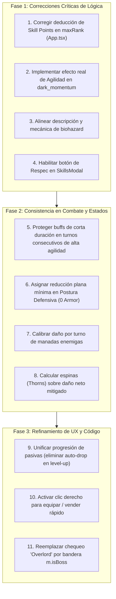

# Reporte Complementario: Auditoría Forense de Incompatibilidades, Errores y Discrepancias de Diseño
**Proyecto:** *Loot of the Dungeon (LoTD)*  
**Fecha de Auditoría:** Noviembre 2026  
**Alcance:** Mecánicas de Juego, Motor de Batalla, Árbol de Pasivas, Progresión y Economía  

---

## 1. Resumen Ejecutivo de Hallazgos

Tras una inspección exhaustiva del código fuente (`useCombatEngine.ts`, `gameLogic.ts`, `gameBalance.ts`, `constants.ts`, `App.tsx` y componentes de interfaz), se identificaron **12 incompatibilidades, errores lógicos y divergencias de diseño**.

### Matriz de Gravedad de los Hallazgos

| Nivel de Gravedad | Cantidad | Descripción General |
| :--- | :---: | :--- |
| 🔴 **Crítico (Bug de Bloqueo / Pérdida de Datos)** | **3** | Pérdida definitiva de puntos de talento, sinergia fantasma (*placebo*) y ausencia de botón de reseteo en UI. |
| 🟡 **Moderado (Incongruencia Lógica / Balance)** | **5** | Expiración prematura de escudos por turnos consecutivos, postura defensiva con armadura 0, divergencia en `biohazard`, pico de daño en manadas y cálculo asimétrico de espinas. |
| 🟢 **Leve / Deuda Técnica (QoL / Fragilidad)** | **4** | Doble progresión de pasivas en subida de nivel, clic derecho anulado (`() => {}`), HP inicial hardcodeado y chequeo rígido de jefes por subcadena `'Overlord'`. |

---

## 2. Diagnóstico Detallado de Errores e Incompatibilidades

---

### 🔴 Hallazgo 1: Pérdida Irreversible de Puntos de Talento al Cliquear Nodos Maximizados (*Skill Point Sink*)
* **Ubicación**: [`LoTD-main/App.tsx:237-246`](file:///c:/Users/CBS-199/Downloads/LoTD-main/LoTD-main/App.tsx#L237-L246)
* **Código Afectado**:
  ```typescript
  setSkillPoints(prev => prev - 1); // <-- Se descuenta el punto aquí
  
  if (existingSkill) {
      // Max rank check
      if (existingSkill.level >= (existingSkill.maxRank || 5)) return; // <-- Sale sin mejorar nada
      
      const nextLevel = existingSkill.level + 1;
      // ... actualización de nivel
  ```
* **El Problema**: La deducción del punto de habilidad (`skillPoints`) se ejecuta en la línea 237, **antes** de verificar si la habilidad ya alcanzó su rango máximo (`existingSkill.level >= maxRank`).
* **Consecuencia**: Si el jugador hace clic sobre un nodo del árbol que ya está en su nivel tope (por ejemplo, rango 1 en una habilidad definitiva o rango 10 en una básica), **el punto se destruye irrevocablemente** sin otorgar ninguna mejora ni advertencia.
* **Solución**: Mover la comprobación de `maxRank` al inicio de la función antes de cualquier modificación de estado.

---

### 🔴 Hallazgo 2: Sinergia Fantasma en `dark_momentum` (*Placebo Code*)
* **Ubicación**: [`LoTD-main/hooks/useCombatEngine.ts:341-344`](file:///c:/Users/CBS-199/Downloads/LoTD-main/LoTD-main/hooks/useCombatEngine.ts#L341-L344) y [`LoTD-main/constants.ts:664-670`](file:///c:/Users/CBS-199/Downloads/LoTD-main/LoTD-main/constants.ts#L664-L670)
* **Definición en `constants.ts`**:
  ```typescript
  id: 'dark_momentum',
  name: 'Dark Momentum',
  themes: [PassiveTheme.SHADOW, PassiveTheme.FORTUNE],
  description: 'Crits grant Speed (Agility) buffs.',
  effect: { trigger: 'onCrit', type: 'synergy_buff', value: 1.5 }
  ```
* **Implementación en el Motor de Combate**:
  ```typescript
  else if (synergy.id === 'dark_momentum' && trigger === 'onCrit') {
       addToCombatLog(`🌑 Dark Momentum: Speed increased!`);
  }
  ```
* **El Problema**: El motor detecta el crítico y muestra el mensaje en pantalla, pero **no agrega ningún efecto de estado**, no modifica la agilidad del jugador ni adelanta su posición en la cola de turnos.
* **Consecuencia**: Es una habilidad meramente decorativa/placebo. El jugador invierte recursos en activar los conjuntos de *Shadow* y *Fortune* creyendo que obtiene velocidad, pero el combate no cambia en nada.

---

### 🔴 Hallazgo 3: Función de Reseteo Inaccesible (*Dead Code en UI*)
* **Ubicación**: [`LoTD-main/App.tsx:278-295`](file:///c:/Users/CBS-199/Downloads/LoTD-main/LoTD-main/App.tsx#L278-L295) y [`LoTD-main/components/SkillsModal.tsx:18`](file:///c:/Users/CBS-199/Downloads/LoTD-main/LoTD-main/components/SkillsModal.tsx#L18)
* **El Problema**: `handleRespecAttributes` está completamente programada en `App.tsx` (cobra `level * 100` de oro y reinicia atributos a 10 devolviendo los puntos), y se inyecta como prop `onRespecAttributes` en `<SkillsModal />`. Sin embargo, dentro de `SkillsModal.tsx`:
  - Solo figura en la interfaz TypeScript `SkillsModalProps`.
  - **No está vinculada a ningún botón en el JSX** ni existe ningún elemento interactivo en toda la interfaz para dispararla.
* **Consecuencia**: El jugador no tiene manera física de resetear sus atributos una vez gastados.

---

### 🟡 Hallazgo 4: Contradicción entre Descripción y Código en `biohazard`
* **Ubicación**: [`LoTD-main/constants.ts:657-662`](file:///c:/Users/CBS-199/Downloads/LoTD-main/LoTD-main/constants.ts#L657-L662) vs [`LoTD-main/hooks/useCombatEngine.ts:544`](file:///c:/Users/CBS-199/Downloads/LoTD-main/LoTD-main/hooks/useCombatEngine.ts#L544)
* **Texto presentado al jugador**:
  > *"Biohazard: Being hit spreads Poison to the attacker automatically."* (Efecto reactivo defensivo de Sombra + Centinela).
* **Comportamiento en combate**:
  ```typescript
  if (isPoisoned && playerStats.activeSynergies.includes('biohazard')) rawDmg *= 1.2;
  ```
* **El Problema**: No existe ningún disparador en `onTakeDamage` para envenenar al agresor. En su lugar, el motor otorga un **+20% de daño ofensivo** al jugador al golpear enemigos que ya estén envenenados.
* **Consecuencia**: Incongruencia total de diseño: el jugador arma una *build* de tanque espinas/veneno esperando represalias al ser golpeado, pero recibe un bono ofensivo que requiere atacar activamente.

---

### 🟡 Hallazgo 5: Expiración Prematura de Escudos por Agilidad (*Agility Turn Batch Bug*)
* **Ubicación**: [`LoTD-main/hooks/useCombatEngine.ts:21-33`](file:///c:/Users/CBS-199/Downloads/LoTD-main/LoTD-main/hooks/useCombatEngine.ts#L21-L33) y [`468-470`](file:///c:/Users/CBS-199/Downloads/LoTD-main/LoTD-main/hooks/useCombatEngine.ts#L468-L470)
* **Mecánica**:
  1. Si la agilidad del jugador duplica la del enemigo, `generateTurnBatch` genera: `['player', 'player', 'enemy']`.
  2. En el Turno 1 del jugador, se dispara una habilidad de escudo defensivo con duración de 1 turno (`duration: 1`).
  3. En el Turno 2 del jugador (consecutivo), se ejecuta `processCombatEffects('player')`.
  4. La duración del escudo pasa de 1 a 0 y es eliminado de `combatStatusEffects`.
  5. En el Turno 3, el enemigo ataca.
* **Consecuencia**: **El escudo se esfuma antes de que el enemigo llegue a atacar**. Tener más agilidad castiga al jugador destruyendo sus propios beneficios defensivos de corta duración antes de que surtan efecto.

---

### 🟡 Hallazgo 6: Postura Defensiva Inoperante con Armadura Cero (*0-Armor Trap*)
* **Ubicación**: [`LoTD-main/hooks/useCombatEngine.ts:651-655`](file:///c:/Users/CBS-199/Downloads/LoTD-main/LoTD-main/hooks/useCombatEngine.ts#L651-L655)
* **Fórmula**:
  ```typescript
  const baseMitigationPercent = BALANCE.COMBAT.calculateMitigationPercent(playerStats.armor, playerStats.level);
  const stanceMult = BALANCE.COMBAT.stanceMultipliers[combatStance];
  const finalMitigationPercent = Math.min(0.85, Math.max(0, baseMitigationPercent * stanceMult.mitigation));
  ```
* **El Problema**: Si el héroe se encuentra sin equipo de armadura o en niveles tempranos con `armor = 0`, `baseMitigationPercent` es exactamente `0`.
  $$\text{Mitigación Final} = 0 \times 1.5 = \mathbf{0\%}$$
* **Consecuencia**: La postura defensiva reduce el daño del jugador un 30% (`rawDmg * 0.7`), pero **no le otorga absolutamente ninguna mitigación** si no posee armadura previa. La postura debería ofrecer un bono plano o armadura ficticia base.

---

### 🟡 Hallazgo 7: Asimetría de Daño en Manadas de Monstruos (*Group Burst Spike*)
* **Ubicación**: [`LoTD-main/services/gameLogic.ts:255`](file:///c:/Users/CBS-199/Downloads/LoTD-main/LoTD-main/services/gameLogic.ts#L255) vs [`LoTD-main/hooks/useCombatEngine.ts:619`](file:///c:/Users/CBS-199/Downloads/LoTD-main/LoTD-main/hooks/useCombatEngine.ts#L619)
* **El Problema**:
  - En `gameLogic.ts`, los monstruos en grupo ven sus estadísticas reducidas al 75% (en dúos) o 60% (en tríos).
  - Pero en `useCombatEngine.ts`, el turno `'enemy'` es único y ejecuta:
    ```typescript
    activeMonsters.forEach(monster => { ... monster ataca ... });
    ```
* **Consecuencia**: En un turno enemigo contra un trío de monstruos, el jugador recibe:
  $$3 \times 60\% = \mathbf{180\%\text{ del daño de un monstruo estándar en un solo turno}}$$
  En combates individuales el daño es 100%. Los combates en manada son casi el doble de letales de lo planeado.

---

### 🟡 Hallazgo 8: Asimetría de Cálculo entre Espinas (*Thorns*) y Robo de Vida (*Life Steal*)
* **Ubicación**: [`LoTD-main/hooks/useCombatEngine.ts:517`](file:///c:/Users/CBS-199/Downloads/LoTD-main/LoTD-main/hooks/useCombatEngine.ts#L517) vs [`LoTD-main/hooks/useCombatEngine.ts:590`](file:///c:/Users/CBS-199/Downloads/LoTD-main/LoTD-main/hooks/useCombatEngine.ts#L590)
* **El Problema**:
  - `lifeSteal` cura según el daño **real mitigado** que recibió el objetivo:
    $$\text{Cura} = \text{DañoNeto} \times \left(\frac{\text{LifeSteal}}{100}\right)$$
  - `thorns` del enemigo refleja daño al jugador según el daño **bruto de la hoja de personaje**:
    $$\text{Reflejo} = \text{PlayerStats.Damage} \times \left(\frac{\text{Thorns}}{100}\right)$$
* **Consecuencia**: El reflejo de espinas castiga al jugador antes de saber si acertó, falló o si el enemigo tiene escudos, y no toma en cuenta la armadura del enemigo. Si el enemigo tiene 10,000 de armadura y recibe 1 de daño, el jugador igual recibe el daño completo de espinas sobre su daño base.

---

### 🟢 Hallazgo 9: Doble Otorgamiento de Pasivas por Nivel (*Double Dipping*)
* **Ubicación**: [`LoTD-main/App.tsx:340-355`](file:///c:/Users/CBS-199/Downloads/LoTD-main/LoTD-main/App.tsx#L340-L355)
* **El Problema**: Al subir de nivel, coexisten dos lógicas no coordinadas:
  1. Se otorga $+1$ punto de talento para gastar libremente en el árbol (`skillPoints`).
  2. Al mismo tiempo, se invoca `generatePassiveSkill()` que selecciona una pasiva al azar y la agrega/equipa automáticamente en `passiveSkills`.
* **Consecuencia**: El jugador progresa el doble de rápido de lo diseñado y recibe habilidades no deseadas que no eligió en su árbol de ramas.

---

### 🟢 Hallazgo 10: Evento Clic Derecho Anulado en el Inventario (`() => {}`)
* **Ubicación**: [`LoTD-main/App.tsx:1084, 1107, 1120`](file:///c:/Users/CBS-199/Downloads/LoTD-main/LoTD-main/App.tsx#L1084)
* **El Problema**: Aunque el componente [`InventorySlot.tsx`](file:///c:/Users/CBS-199/Downloads/LoTD-main/LoTD-main/components/InventorySlot.tsx) captura `onContextMenu` para permitir clic derecho, en `App.tsx` se le suministra `onRightClick={() => {}}`.
* **Consecuencia**: Los jugadores se ven obligados a arrastrar (*drag & drop*) cada ítem individualmente para equipar o vender.

---

### 🟢 Hallazgo 11: HP Inicial Hardcodeado en Nueva Partida
* **Ubicación**: [`LoTD-main/App.tsx:158`](file:///c:/Users/CBS-199/Downloads/LoTD-main/LoTD-main/App.tsx#L158)
* **El Problema**: Se ejecuta `setPlayerCurrentHp(195);` con un número literal quemado en el código, en lugar de invocar `calculatePlayerStats()`.
* **Consecuencia**: Si en el futuro se modifican los atributos iniciales o la fórmula de vida, la vida inicial quedará desfasada de la vida máxima calculada.

---

### 🟢 Hallazgo 12: Detección Frágil de Jefes por Subcadena Literal (`'Overlord'`)
* **Ubicación**: [`LoTD-main/App.tsx:407`](file:///c:/Users/CBS-199/Downloads/LoTD-main/LoTD-main/App.tsx#L407)
* **El Problema**: Para registrar la victoria sobre el Jefe y limpiar el área, el código comprueba:
  ```typescript
  const boss = monsters.find(m => m.rarity === MonsterRarity.UNIQUE && m.name.includes('Overlord'));
  ```
* **Consecuencia**: La lógica depende de una coincidencia exacta de texto añadida manualmente en `handleExplore` (`boss.name = 'Overlord ' + boss.name`). Si se cambia la nomenclatura o se añade un jefe con otro título, el área no se marca como completada y el mapa queda bloqueado. Debería evaluarse una bandera booleana explícita (`isBoss: true`).

---

## 3. Plan de Acción Recomendado de Correcciones


