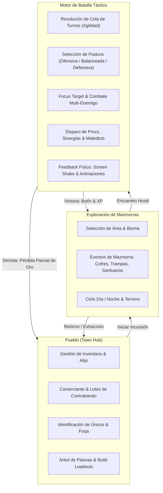
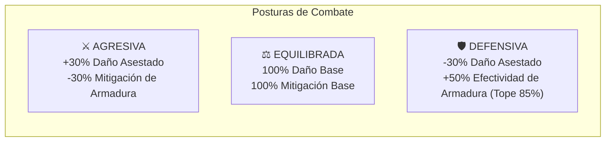
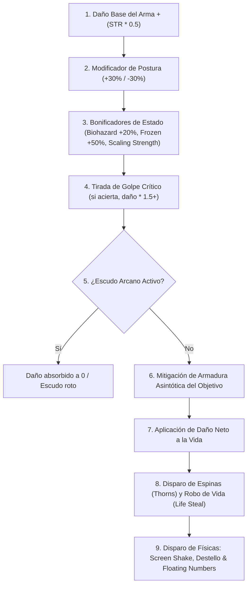
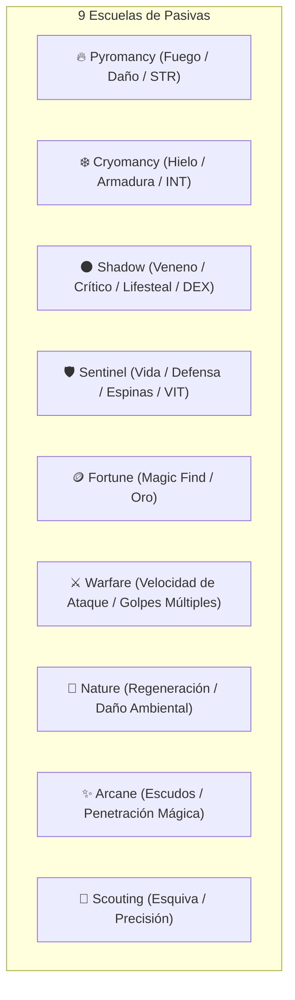

# Reporte Detallado de Mecánicas de Juego y Motor de Batalla
**Proyecto:** *Loot of the Dungeon (LoTD)*  
**Fecha de Diagnóstico:** Noviembre 2026  
**Motor Técnico:** React 19 + TypeScript + Vite + Tailwind CSS / Procedural Canvas

---

## 1. Visión General del Bucle de Juego (*Core Game Loop*)

*Loot of the Dungeon* combina la itemización profunda y adictiva de los ARPG clásicos (*Diablo II*, *Path of Exile*) con la deliberación estratégica de un sistema de combate táctico por turnos y exploración *roguelite*.

---

## 2. Sistema del Héroe y Arquitectura de Estadísticas

### 2.1. Atributos Base Primarios
El personaje se define a partir de cuatro atributos troncales (cada uno inicia en 10 puntos base):

| Atributo | Rol Primario | Escalado Directo | Sinergia Temática |
| :--- | :--- | :--- | :--- |
| **Fuerza (STR)** | Daño físico | $+0.5$ Daño plano por punto de Fuerza | *Pyromancy* y *Warfare* |
| **Destreza (DEX)** | Velocidad y defensa | $+0.5$ Armadura, $+0.2\%$ Probabilidad de Esquiva | *Shadow* y Agilidad de Turnos |
| **Inteligencia (INT)** | Precisión y magia | $+0.2\%$ Probabilidad de Golpe Crítico | *Cryomancy* y *Arcane* |
| **Vitalidad (VIT)** | Supervivencia | $+8$ Puntos de Vida Máxima ($\text{MaxHP}$) por punto | *Sentinel* y Resistencia a DoTs |

### 2.2. Progresión por Nivel
Al subir de nivel, el héroe recibe:
- **$+3$ Puntos de Atributo** para distribuir libremente entre STR, DEX, INT y VIT.
- **$+1$ Punto de Talento** para invertir en el Árbol de Habilidades Pasivas.
- **$+15$ Puntos de Vida Máxima** adicionales de base.

### 2.3. Fórmulas Matemáticas Clave

#### A. Vida Máxima del Héroe ($\text{MaxHP}$)
$$\text{MaxHP} = 100 + (\text{Vitalidad} \times 8) + (\text{Nivel} \times 15)$$
*A Nivel 1 con 10 de Vitalidad, el jugador arranca con **195 HP**, otorgando un margen táctico saludable para recibir ataques y experimentar con posturas.*

#### B. Mitigación de Daño Asintótica por Armadura
$$\text{Mitigación\%} = \min\left(0.80, \frac{\text{Armadura}}{\text{Armadura} + (40 \times \text{Nivel}) + 50}\right)$$
*Esta curva evita que acumular armadura rompa el juego (impide alcanzar el 100% de invulnerabilidad). Conforme el nivel del área aumenta, el héroe requiere armaduras de mayor nivel para mantener porcentajes de reducción idénticos.*

#### C. Probabilidades de Combate
- **Probabilidad Crítica ($\text{CritChance}$)**: Base $5\% + (\text{INT} \times 0.2\%) + \text{Objetos}$. Tope máximo: **$100\%$**. Multiplicador base: **$\times 1.5$** (ampliable mediante gemas y pasivas).
- **Probabilidad de Esquiva ($\text{DodgeChance}$)**: Base $0\% + (\text{DEX} \times 0.2\%) + \text{Objetos}$. Tope máximo: **$75\%$**.

---

## 3. Motor de Batalla (*Combat Engine Deep Dive*)

El combate se ejecuta mediante un sistema de turnos continuos por iniciativa, simulando intercambios tácticos dinámicos.

### 3.1. Determinación de Iniciativa y Cola de Turnos
La frecuencia de ataque se resuelve comparando la agilidad del jugador con la agilidad promedio del grupo enemigo:

$$\text{Agilidad}_{\text{jugador}} = \text{DEX} \times 0.8^{\text{Cargas de Chill}}$$

- Si la agilidad de un combatiente duplica la del rival, obtiene **2 acciones consecutivas** en la cola de turnos.
- La cola genera lotes de turnos visuales representados en la barra superior del modal.
- Estados como `Freeze` o `Stun` provocan la pérdida inmediata del turno del actor afectado.

### 3.2. Posturas de Combate Tácticas (*Combat Stances*)
El jugador puede alterar su postura de combate en cualquier momento con un solo clic:

### 3.3. Encuentros Multi-Enemigo y *Focus Targeting*
A partir del nivel 4, el jugador puede enfrentarse a manadas de 2 o 3 monstruos simultáneos.
- **Escalado de Manada**: Para mantener la equidad táctica, en grupos de 2 enemigos sus estadísticas individuales se escalan al **75%**; en manadas de 3, al **60%**.
- **Retícula de Enfoque (*Focus Target*)**: El jugador puede hacer clic sobre cualquier monstruo para fijarlo como objetivo prioritario (marcado con 🎯 y un aura de seguimiento). De no seleccionar ninguno, el motor ataca automáticamente al primer enemigo con vida.

### 3.4. Pipeline de Cálculo de Daño

### 3.5. Estados Alterados y Efectos de Estado
- **DoTs (Daño Continuo)**:
  - `Burn`: Quema fuego puro al inicio del turno.
  - `Poison`: Daño de veneno acumulable con límite del 5% del MaxHP por carga.
- **Control de Masas (CC)**:
  - `Chill`: Reduce la velocidad de ataque/agilidad en 20% por carga.
  - `Freeze` / `Stun`: Incapacita al combatiente, omitiendo su turno.
  - `Blind`: Provoca que los ataques del afectado fallen.
- **Defensas y Buffs**:
  - `Shield`: Bloquea completamente el siguiente impacto recibido.
  - `Scaling Strength`: Incrementa el daño acumulativamente en combates largos.
  - `Tidal Regen`: Regeneración pasiva por turno.

### 3.6. Afijos Maledict de Monstruos de Élite
Los monstruos de rarezas superiores (*Uncommon* a *Unique*) generan entre 1 y 5 afijos maledict reactivos:
- **Arcane Shield**: Genera un escudo impenetrable que absorbe el siguiente impacto letal.
- **Plague Cloud**: Emite nubes de veneno al ser golpeado.
- **Executioner**: Duplica el daño del monstruo si la vida del héroe cae por debajo del 30%.
- **Thorns**: Refleja pasivamente un porcentaje del daño recibido al atacante.
- **Shuffle Turn**: Altera caóticamente el orden de la cola de turnos.

---

## 4. Árbol de Habilidades Pasivas y Sinergias Compuestas

El sistema cuenta con **57 nodos pasivos** estructurados en 9 escuelas arquetípicas:

### 4.1. Bonificaciones de Conjunto (*Set Bonuses*)
Al equipar un número determinado de habilidades de la misma temática (por ejemplo, 3 nodos de *Pyromancy*), se activa un talento pasivo de conjunto que otorga estadísticas permanentes y una habilidad reactiva (proc) en combate.

### 4.2. Sinergias Compuestas (*Composite Synergies*)
Al combinar dos bonificaciones de conjunto distintas, se desencadena una sinergia híbrida de alto nivel:
1. **Biohazard** (*Shadow + Pyromancy*): Los ataques contra objetivos envenenados causan un **+20% de daño adicional**.
2. **Frostburn** (*Cryomancy + Pyromancy*): Al golpear a un enemigo que tenga el estado `Chill` o `Freeze`, se produce una explosión de vapor hirviente que inflige daño instantáneo de área.
3. **Dark Momentum** (*Shadow + Warfare*): Cada golpe crítico incrementa la velocidad de ataque y adelanta la siguiente acción del jugador.

---

## 5. Economía, Botín (*Loot*) y Equipamiento

### 5.1. Ranuras de Equipamiento (9 Slots)
El héroe equipa objetos en 9 casillas:
- **Casco**, **Pechera**, **Guantes**, **Pantalones**, **Botas**.
- **Arma Principal** (*Main Hand*) y **Mano Torpe** (*Off Hand* / Escudo / Orbe / Tomo).
- **Amuleto** y **Anillo**.

### 5.2. Niveles de Rareza de Ítems
| Rareza | Afijos Máximos | Multiplicador de Estadísticas | Identificación |
| :--- | :---: | :---: | :--- |
| **Common (Blanco)** | 1 | $1.0\times$ | Identificado de fábrica |
| **Magic (Azul)** | 2 | $1.2\times$ | Identificado de fábrica |
| **Rare (Amarillo)** | 4 | $1.5\times$ | Identificado de fábrica |
| **Unique (Dorado)** | 6 | $2.0\times$ | Requiere pergamino o identificación en el pueblo |

### 5.3. Sistema de Hallazgo Mágico (*Magic Find - MF*)
El *Magic Find* aumenta porcentualmente las probabilidades de que un objeto caído suba de categoría a Mágico, Raro o Único. Para evitar drops garantizados del 100%, existen topes estrictos (*caps*):
- Máximo de objetos Únicos: **25% de probabilidad tope**.
- Máximo de objetos Raros: **50% de probabilidad tope**.
- Máximo de objetos Mágicos: **90% de probabilidad tope**.

### 5.4. Lotes de Contrabando (*Smuggling Bundles*)
En el pueblo, el comerciante ofrece cajas misteriosas de contrabando que garantizan rarezas mínimas a cambio de una inversión sustancial en oro.

---

## 6. Exploración, Biomas y Eventos del Mundo

### 6.1. Los 6 Biomas y Terrenos
Cada nodo del mapa de mazmorras pertenece a uno de los 6 terrenos con su propio fondo de batalla (*battleback*) animado:
- **Ruins**: Ruinas ancestrales con alta presencia de gólems de piedra y armaduras antiguas.
- **Forest**: Bosques con insectos venenosos y bestias feroces.
- **Crypt**: Criptas sombrías con espíritus, zombis y señores del inframundo.
- **Swamp**: Ciénagas ácidas donde proliferan criaturas de fango y veneno.
- **Plains**: Llanuras abiertas con bestias salvajes veloces y cazadores.
- **Void**: El abismo exterior donde habitan los jefes míticos más desafiantes.

### 6.2. Ciclo Día / Noche y Modificadores de Entorno
El mundo oscila dinámicamente entre el día y la noche, afectando habilidades de sigilo y visión:
- `Night Prowler`: Otorga $+25\%$ de probabilidad crítica durante la noche.
- `Forest Fire`: Otorga $+20\%$ de daño ígneo en terrenos de bosque.
- `Tidal Affinity`: Regenera 5% de HP por turno en pantanos.

### 6.3. Eventos de Exploración
- **Santuarios (*Shrines*)**: Otorgan bendiciones temporales (aumento de daño, armadura o velocidad) por varias batallas.
- **Cofres de Tesoro (*Treasure*)**: Proporcionan oro y tiradas de botín gratuitas.
- **Trampas (*Traps*)**: Pruebas de destreza que pueden infligir daño porcentual al héroe o envenenarlo.
- **Encuentros Hostiles (*Encounters*)**: Inician de inmediato el combate táctico.

---

## 7. Resumen de Estado de Mejoras y Balance

| Componente | Estado Anterior | Estado Actual (Post-Optimizaciones) |
| :--- | :--- | :--- |
| **Vida Inicial del Héroe** | 60 HP (Derrota en 3 turnos) | **195 HP** base a nivel 1 (Óptimo y táctico) |
| **Rareza Temprana de Monstruos** | Mobs épicos en nivel 1 | **Filtrado estricto**: Niveles 1-3 enfrentan únicamente Común/Poco Común/Raro |
| **Sprites de Monstruos** | Imágenes estáticas de 1 frame | **100 Sprites GIF multiframe** (50 normales + 50 shiny con 30-120 frames c/u) |
| **Físicas de Combate** | Intercambio plano sin animación | **Respiración sinusoidal**, sombras oscilantes, retroceso y flash al daño |
| **Feedback de Impacto** | Texto estático de log | **Screen Shake dinámico** (Ligero en impactos, Pesado en críticos y ejecuciones) |
| **Pociones de Combate** | Inexistentes | **2 Cargas de Poción de Emergencia** (35% HP instantáneo) |
